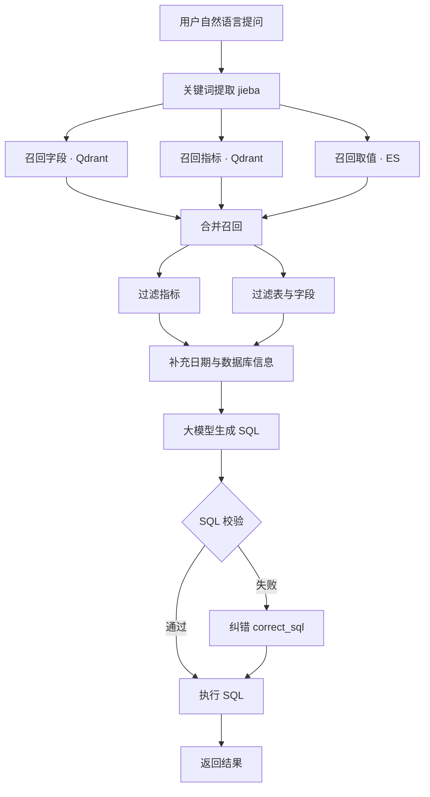

# 🔍 智能问数（NL2SQL + RAG）

> 用一句大白话提问，系统自动检索元数据、生成并校验 SQL，最终从数据库查出答案。
> 一个基于 **RAG 检索增强** 的自然语言问数系统，全程流式展示执行过程。


---

## 📑 目录

- [✨ 功能亮点](#-功能亮点)
- [🧰 技术栈](#-技术栈)
- [🏗️ 系统架构](#️-系统架构)
- [📁 项目结构](#-项目结构)
- [🚀 快速开始](#-快速开始)
- [⚙️ 配置说明](#️-配置说明)
- [💬 试试这些问题](#-试试这些问题)
- [🔌 端口与账号](#-端口与账号)

---

## ✨ 功能亮点

- **自然语言转 SQL（NL2SQL）**：无需懂 SQL，口语化提问即可查数据
- **RAG 检索增强**：先多路召回真实的字段、指标、枚举值，再让大模型生成，避免凭空编造
- **双路检索结合**：Qdrant 向量语义检索 + Elasticsearch 全文精确检索
- **SQL 校验与纠错**：生成后先做语法校验，失败自动走纠错分支，提升容错性
- **流式响应（SSE）**：执行进度和结果实时推送到前端，过程一目了然
- **容器化部署**：Docker Compose 一键编排 5 个中间件

---

## 🧰 技术栈

| 分层 | 技术 |
|---|---|
| **后端** | Python 3.13、FastAPI、Uvicorn、Pydantic |
| **AI 编排** | LangChain、LangGraph、Prompt Engineering |
| **大模型** | DeepSeek（NL2SQL）、BGE-large-zh（中文 Embedding） |
| **数据存储** | MySQL 8.0、Qdrant（向量库）、Elasticsearch、Kibana |
| **工具库** | SQLAlchemy（异步 ORM）、jieba（中文分词）、Loguru（日志） |
| **前端** | Vue 3、Vite |
| **部署** | Docker、Docker Compose、SSE 流式输出 |

---

## 🏗️ 系统架构

一个问题从进门到出答案，由 LangGraph 编排多个节点完成，含并行召回与条件纠错分支：



**三个存储分工：**

| 存储 | 职责 |
|---|---|
| MySQL `meta` 库 | 存完整元数据档案 |
| MySQL `dw` 库 | 存真实业务数据（1 张事实表 + 4 张维度表） |
| Qdrant | 存向量，按语义找相似字段 / 指标 |
| Elasticsearch | 存枚举取值，按关键词精确匹配 |

---

## 📁 项目结构

```
智能问数/
├─ data-agent/                    # 后端
│  ├─ app/
│  │  ├─ agent/
│  │  │  ├─ nodes/                # 12 个节点（召回、过滤、生成、校验、执行）
│  │  │  ├─ graph.py              # LangGraph 流程图
│  │  │  ├─ state.py              # 状态托盘
│  │  │  ├─ context.py            # 上下文工具包
│  │  │  └─ llm.py                # 大模型对象
│  │  ├─ api/                     # 路由与数据校验
│  │  ├─ services/                # 业务服务
│  │  ├─ repositories/            # 仓库层（具体查、存）
│  │  ├─ clients/                 # 连接管理
│  │  └─ models/                  # 数据模型
│  ├─ conf/                       # 配置文件
│  ├─ prompts/                    # 提示词模板
│  ├─ docker/                     # Docker Compose 与镜像
│  └─ main.py                     # 入口
├─ date-agent-frontend/           # 前端 Vue3 + Vite
└─ 问数流水线图.html               # 独立可视化流程图
```

---

## 🚀 快速开始

### 1. 启动中间件

打开 Docker Desktop，确认 5 个容器均为 `Up`：

```
mysql、qdrant、elasticsearch、kibana、embedding
```

### 2. 启动后端（data-agent 目录）

```cmd
.venv\Scripts\python.exe -m uvicorn main:app --port 8000
```

> 建议使用 `.venv` 完整路径，避免被系统中其他 Python 环境干扰。

### 3. 启动前端（date-agent-frontend 目录，新开终端）

```cmd
npm run dev
```

### 4. 浏览器访问

```
http://localhost:5173
```

后端接口文档：`http://localhost:8000/docs`

---

## ⚙️ 配置说明

真实配置文件 `app_config.yaml` 已通过 `.gitignore` 忽略，**不会上传密钥**。首次使用：

1. 复制模板：

```cmd
copy conf\app_config.example.yaml conf\app_config.yaml
```

2. 在 `app_config.yaml` 中填入你自己的 DeepSeek API Key：

```yaml
llm:
  model_name: deepseek-chat
  api_key: sk-你的真实Key
```

---

## 💬 试试这些问题

| 类型 | 示例问题 |
|---|---|
| 基础问数 | 统计华北地区销售总额 |
| 口语化 | 华北卖了多少钱？ |
| 多地区汇总 | 2025 年各地区的 GMV 是多少 |
| 排名 TOP3 | 各地区销量排名前三的商品 |
| 时间维度 | 3 月销售额 TOP3 的商品 |
| 边界探索 | 你好（无闲聊能力，返回 SELECT 1） |

---

## 🔌 端口与账号

| 服务 | 端口 |
|---|---|
| 前端 Vite | 5173 |
| 后端 FastAPI | 8000 |
| MySQL | 3307 |
| Elasticsearch | 9200 |
| Kibana | 5601 |
| Qdrant | 6333 / 6334 |
| Embedding | 8081 |

- MySQL 账号：`atguigu` / `Atguigu.123`
- 数据库：`meta`（元数据）、`dw`（数据仓库）
